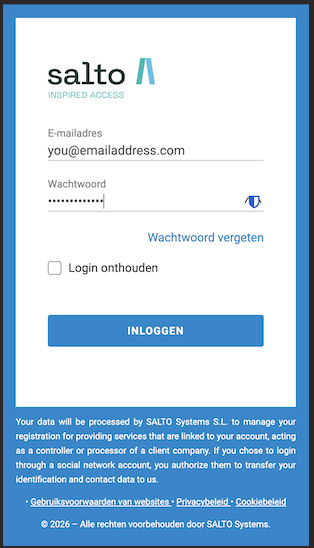
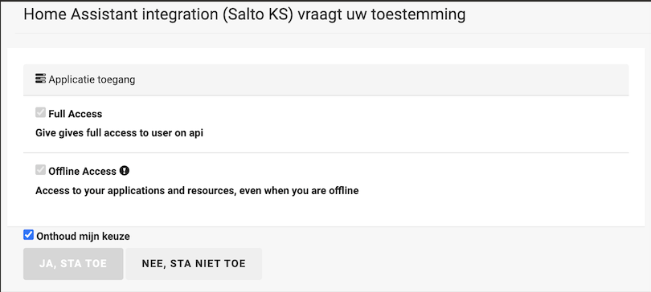
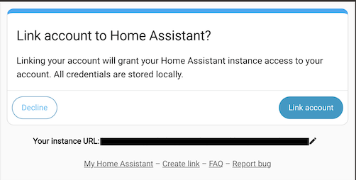

# Unofficial Salto KS Custom Integration for Home Assistant

This integration polls the Salto KS cloud API (configurable, default every 10 seconds) and exposes all information about the sites you are allowed to see with the account you are using and the locks within those sites you have access to.

>Like the name suggests, this is an *unofficial* Salto KS integration. It is not provided by or maintained by any Salto Systems or Salto Group company.

The locks are controlled via a feature in Salto KS called "remote opening". The account used for this integration must have the appropriate permission to perform remote openings. Since Salto KS is an always online real time cloud locking solution, this usually works pretty fast. However, in case there is an issue with connectivity, the operation might not work. If the unlock command could not be delivered, it will expire and become invalid within a few minutes. The integration will keep polling for lock state changes, so as soon as connectivity is restored, the correct state will be reflected.

## Installation

1. *HACS* (or settings → marketplace) → three dots → *Custom repositories* → add `https://github.com/medivb/ha-salto-ks` as type *Integration*, then install **Salto KS**. Or copy `custom_components/saltoks` into your Home Assistant `config/custom_components/` folder.
2. Restart Home Assistant.
3. *Settings → Devices & services → Add integration → Salto KS*.
4. Select *Open website* to go to the Salto KS login page, and sign in with the account you use for the Salto KS web app.
5. After signing in you are sent back to Home Assistant through My Home Assistant (`my.home-assistant.io`). The first time, that page asks for the address of your Home Assistant.

Update interval and other options: *Configure* on the integration (update interval 5–300 seconds, default 10).

## Sign-in

- You sign in on the normal Salto KS login page in your browser. Home Assistant never sees your password.
- The login page always asks for your username and password, also when your browser is already signed in to Salto KS, so you choose which account Home Assistant uses. When signing in again, the account of the existing setup is filled in and another account is refused; to use another account, see [Switching to another account](#switching-to-another-account).
  
  
- The first time, the login page asks you to allow the Salto KS integration access to your account.
  
  
- After this, Home Assistant asks you once for permission to allow the call-back to your installation. 
  
  
- Home Assistant only stores a sign-in token, which it renews on its own. No password or client secret is stored.
- Any Salto KS account can be used; no separate client ID or client secret is needed.
- If the sign-in expires or is revoked (for example after a password change), Home Assistant asks you to sign in again.

### Switching to another account

Choose *Reconfigure* on the integration (*Settings → Devices & services → Salto KS*, three dots) to sign in with a different Salto KS account. Home Assistant first explains the consequences, then opens the Salto KS login page.

After switching:

- sites and locks that the new account can access keep working as before, including their history;
- sites and locks that the new account cannot access become *unavailable*; you can remove those devices on their device page;
- sites and locks that only the new account can access are added;
- a new account device is created, and the device of the previous account becomes *unavailable* (you can remove it).

Locking, unlocking and Easy Office Mode changes depend on the permissions of the new account. An account that is already set up as a separate integration entry cannot be selected.

## Devices

The integration creates:

- one device for your account, with your profile picture and account details;
- one device per site, named after the site;
- one device per lock, named after the lock and linked to its site.

Each lock device holds the lock itself, its Easy Office Mode settings, and its last entry and last incident. The lock's details are attributes of the lock entity.

The entity IDs of a lock's entities start with the site name and the lock name, for example `lock.house_of_broeks_voordeur` and `event.house_of_broeks_voordeur_last_entry`. Other entity IDs of lock entities, also ones you changed yourself or that Home Assistant restores when a removed lock comes back, are renamed to this form when the integration starts, unless that ID is already used by another entity.

## Locks

- Locking or unlocking a lock shows it as *locking* / *unlocking* until Salto KS confirms the new state, usually within a few seconds.
- If the new state is not confirmed within 10 seconds, the lock shows the state reported by Salto KS and a warning is written to the log. The regular updates continue as usual.

## Easy Office Mode

Easy Office Mode is a schedule per lock. On the selected weekdays, between the start and end date, the lock can stay unlocked during the daily time window and is locked automatically at the end time. With *auto start* on, the lock is also unlocked automatically when the window starts. All times and dates are local time.

Each lock device has these settings:

| Setting | What it does |
|---|---|
| Easy Office Mode auto start | Unlock automatically when the window starts |
| Easy Office Mode Monday … Sunday | The days on which the schedule applies |
| Easy Office Mode start time / end time | The daily time window |
| Easy Office Mode start date / end date | The period in which the schedule applies; the end date is included |
| Remove Easy Office Mode schedule | Removes the schedule from the lock |

- Changes are saved in Salto KS straight away.
- The end time must be later than the start time, and the end date may not be before the start date.
- The end date is optional. Without an end date the schedule applies indefinitely; the end date then shows as *unknown*. To remove an end date, use the action below.
- A lock without a schedule shows all days off and no times or dates. The first change you make creates a schedule with: auto start and all days off, 09:00–17:00, today as start date and no end date.
- The remove button is only available while the lock has a schedule. Home Assistant does not ask for confirmation when you press it.

### Action: Set Easy Office Mode schedule

Changes several settings at once, for one or more locks. Settings you leave out stay as they are. `days` lists the days on which the schedule applies; other days are switched off. Use `end_date: null` to remove the end date.

```yaml
action: saltoks.set_easy_office_mode_schedule
target:
  entity_id:
    - lock.front_door
    - lock.back_door
data:
  auto_start: true
  days: [monday, tuesday, wednesday, thursday, friday]
  start_time: "08:00"
  end_time: "17:30"
  start_date: "2026-01-01"
  end_date: "2026-12-31"
```

### Action: Remove Easy Office Mode schedule

Removes the schedule from one or more locks.

```yaml
action: saltoks.remove_easy_office_mode_schedule
target:
  entity_id:
    - lock.front_door
    - lock.back_door
```

## Last entry and last incident

Each lock device has two events:

- **Last entry**: when the lock was last used and what happened, for example a successful opening or a denied opening attempt.
- **Last incident**: the most recent incident reported for the lock.

Every new entry or incident is recorded in the history and logbook of Home Assistant and can be used to trigger automations.

The event is described as *category - detail - user*, for example `Opening - Offline - Jane Doe`. Parts without a value are left out, so it can also be `Opening - Jane Doe` or just `Opening`. Incidents never include a user. The time of the event is shown in local time (`local_date_time`).

- Only entries and incidents that happen while Home Assistant is running are reported. After the integration is first added, each lock shows its most recent entry and incident.
- By default, entries do **not** include who used the lock. To include the person's name, alias and picture, turn on *Include user details in entries* under *Configure* on the integration. This is personal data and is stored in your Home Assistant history; only turn it on if you are allowed to keep this information.

Example: notify when the front door is opened. The condition uses `event_category`, so it works regardless of the detail and the user.

```yaml
triggers:
  - trigger: state
    entity_id: event.front_door_last_entry
    not_from: unavailable
conditions:
  - condition: state
    entity_id: event.front_door_last_entry
    attribute: event_category
    state: Opening
actions:
  - action: notify.my_mobile
    data:
      message: >
        Front door: {{ state_attr('event.front_door_last_entry', 'event_type') }}
```

The descriptions depend on what Salto KS reports and are added as they occur; the most recent ones are listed in the `event_types` attribute of the entity.

## Details per account, site and lock

- **Locks:** all information Salto KS provides about a lock (for example battery level, online status, floor and gateway details) is available as attributes of the lock entity. You see them under *Attributes* in the lock's dialog, and can use them in templates, for example `{{ state_attr('lock.house_of_broeks_voordeur', 'battery_level') }}`.
- **Account and sites:** all other information is shown as entities in the *Diagnostic* section of the account and site devices. Pictures are shown as image entities.

New information is added automatically when Salto KS starts providing it.

Technical identifiers are disabled by default. To use one, open the entity settings and turn on *Enabled*.

*Download diagnostics* on the integration gives all collected information, with credentials and personal data removed.

## Please note

Every update contacts Salto KS a few times per site. With many sites, or if Salto KS limits the number of requests for your account, increase the update interval under *Configure*.

## Tests

```bash
pip install pytest-homeassistant-custom-component
pytest
```

